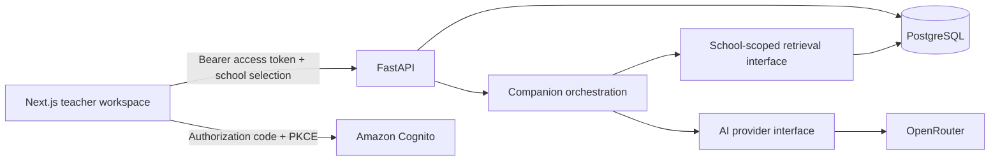

# Architecture and boundaries

The first release targets one school and teacher/admin accounts in a responsive browser application. School identity is present from the first schema so future schools do not require a separate database design.

This is a modular monolith backend. Avoid independent microservices until operational needs justify them. Next.js owns presentation and browser authentication; Python owns business rules, school access, persistence, and AI calls. Add business APIs to Python rather than duplicating rules in Next.js routes.

## Data ownership

- `School` is the tenant boundary.
- `User.subject` maps to a verified Cognito `sub`; a user can have memberships in multiple schools.
- `Membership` stores the server-owned school role (`teacher` or `admin`). Browser headers cannot grant membership or privileges.
- Curriculum records belong to a school. Both roles can read; only administrators can create records in this starter.
- Lesson drafts belong to a school and an author; teachers read only their own drafts. Sharing, publishing, and administrator inspection are future permission decisions.
- Conversations belong to a school and a user. Their messages are read into a bounded prompt only after those ownership checks.

`X-School-ID` selects among the authenticated user's memberships. With one membership the header is optional. With multiple memberships it is required. All protected queries must include ownership constraints. Cross-school curriculum references in lessons are additionally blocked by a composite database foreign key. There is no PostgreSQL row-level security yet; isolation depends on explicit application checks plus tests.

## Request path

1. Validate the Cognito access token (signature, RS256 algorithm, issuer, expiry, token use, and app client).
2. Resolve its subject to a provisioned user.
3. Resolve and authorize school membership.
4. Validate request input and execute a school-scoped query.
5. Commit changes only after the operation succeeds.

The public endpoints are liveness/readiness and OpenAPI documentation. Configuration defaults to Cognito and requires its settings; only the explicit local example environment enables demo auth.

## Starter boundaries

The current UI supports curriculum creation/read, lesson draft creation/read, school selection, and companion chat. It does not yet include editing/deleting records, scheduled lessons, student accounts, grades, attendance, document uploads, user invitation screens, payments, streaming responses, or a chat history browser. The backend stores chat turns, but continuing a conversation after reload requires its ID or future history UI.

The retrieval interface presently loads one explicitly selected curriculum record; it does not search uploaded files. Direct SQLAlchemy sessions and synchronous HTTP calls run in FastAPI's threadpool. Move to async I/O, background processing, or queues when measured workloads require them.
